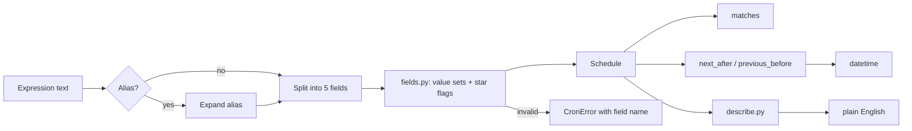

# Architecture

Cronplain is three pure modules plus a thin command-line wrapper. Nothing
holds global state, every function is deterministic, and no call touches the
network, the filesystem, or the clock unless the caller asks for "now".

## Data flow

Expression text enters through `parse()` or the CLI, becomes an immutable
`Schedule` of value sets and star flags, and leaves as booleans from
`matches()`, datetimes from `next_after()` / `previous_before()`, or a
description string.

## Modules

- `fields.py` owns the grammar. It turns one field of text into a value set
  plus a flag recording whether the field starts with `*`, and it owns every
  error message. Name tables for months and weekdays live here.
- `schedule.py` owns semantics. It evaluates minute, hour, and month
  membership, applies the Vixie day-field rule, and walks the calendar in
  both directions. The walk jumps a whole day (or month) whenever the
  current unit cannot match, so long gaps cost a handful of iterations.
- `describe.py` owns wording. It compresses value sets into runs, steps, and
  ranges, then composes sentences from fixed phrase templates. Because output
  depends only on the value sets, equivalent expressions always describe
  identically — `0 0 * * 0` and `0 0 * * 7` share one description.
- `cli.py` maps subcommands onto the library and converts errors into exit
  status 1. It never formats anything the library could format.

## Error model

`CronError` is a `ValueError` subclass carrying the field name that failed.
`NoMatchError` extends it for schedules no calendar can satisfy, such as
`0 0 31 2 *`. Parsing wraps unexpected internal failures into `CronError`,
so callers handling one type handle every failure mode.

## Iteration strategy

The naive approach steps minute by minute, which turns a yearly schedule
into half a million iterations. Cronplain instead checks units from coarse
to fine: jump to the next allowed month, then the next allowed day, then the
next allowed hour, then the next allowed minute. Each jump strictly moves
forward (or backward), so termination is structural; a twelve-year ceiling
bounds the search and turns impossible schedules into errors.

## Extension points

A six-field Quartz variant would add a seconds field and a year selector
ahead of the existing five. Timezone-aware iteration would wrap the calendar
walk with zone conversions. Both stay out of scope for 0.1.0 and are listed
in the specification roadmap.
