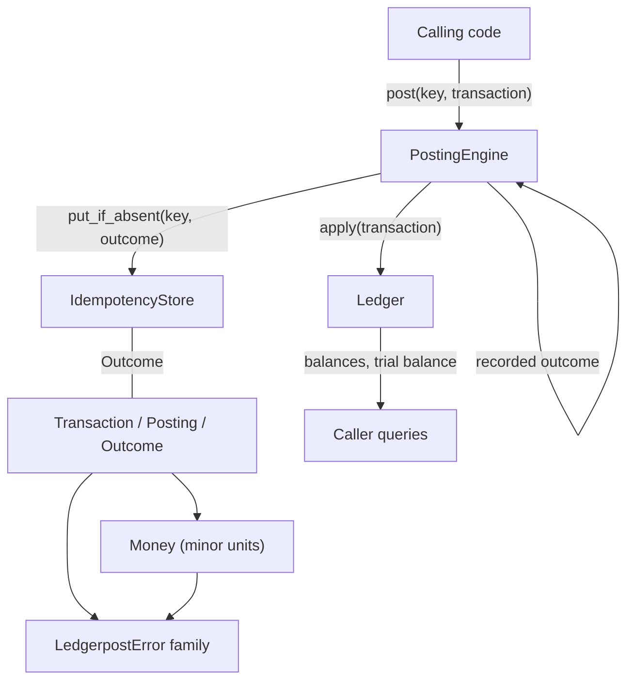

# Architecture

Ledgerpost is an in-process library with six small modules and one direction of dependency flow.
There is no server, no background work, and no global state.

## Components

```
engine.py        claim-then-apply flow; the only entry point callers need
store.py         IdempotencyStore protocol + MemoryIdempotencyStore (thread-safe)
ledger.py        append-only log, running balances, trial balance
model.py         Direction, Posting, Transaction, Outcome (validated, frozen)
money.py         Money: integer minor units, allocation
errors.py        typed exception family
```

Dependency arrows point downward only: `engine` -> `store`, `ledger`, `model`; `ledger` -> `model`;
`model` -> `money`; `money` -> `errors`.



## The claim-then-apply flow

`PostingEngine.post` performs exactly two steps:

1. **Claim.** `put_if_absent(key, Outcome(transaction, replayed=False))` decides the winner
   atomically. The store returns `(claimed, recorded)`.
2. **Apply.** If this call claimed the key, the transaction goes to `Ledger.apply` and the fresh
   outcome returns. Otherwise the recorded transaction returns with `replayed=True` and the ledger
   is untouched.

Because the claim precedes any ledger mutation, concurrent callers racing on one key cannot apply
a transaction twice even under thread interleaving: exactly one call wins the claim, and every
loser sees the winner's transaction. Distinct keys claim independently; `Ledger.apply` takes its
own lock, so concurrent applications of different transactions serialize safely.

Validated transactions make step 2 infallible: a `Transaction` cannot exist unbalanced or
malformed, so `apply` only updates dictionaries and cannot raise on accepted input.

## Invariants

- Every accepted `Transaction` balances per currency at construction
- One request key applies at most once for the lifetime of the store
- `trial_balance()` is zero per currency for any ledger fed through the engine
- Outcomes are frozen; a replay returns the identical recorded transaction
- The engine generates no identifiers and reads no clock

## Error model

`LedgerpostError` roots three families: `MoneyError` (amounts and currencies), `TransactionError`
(posting and balance faults), `StoreError` (request-key hygiene). Callers catch the base or branch
on specific cases; messages quote the offending value.

## Extension points

**Durable stores.** Implement `IdempotencyStore` over your database. Two rules keep the guarantee
intact: `put_if_absent` must be atomic under concurrency, and the key table belongs in the same
transaction boundary as the ledger rows it guards. A backend that stores the key and the posting
in one commit turns the engine's in-process exactly-once into a restart-safe exactly-once.

**Query surface.** `Ledger.balance` and `Ledger.trial_balance` read the running totals; heavier
reporting builds on `Ledger.transactions()` snapshots without touching the write path.

## Performance shape

Posting costs O(postings in the transaction) plus one dictionary update per posting. Balances are
precomputed on apply, so queries are O(accounts touched by that account or currency filter). The
reference store is a dictionary under a lock: O(1) claims. Ten thousand sequential postings
complete in well under a second on current commodity hardware.
